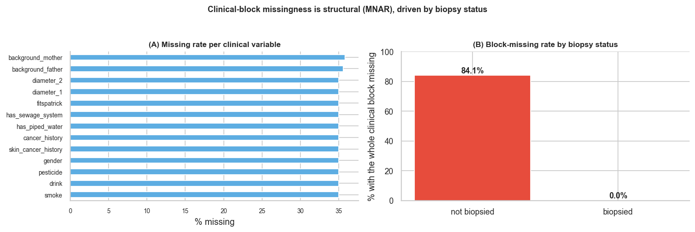
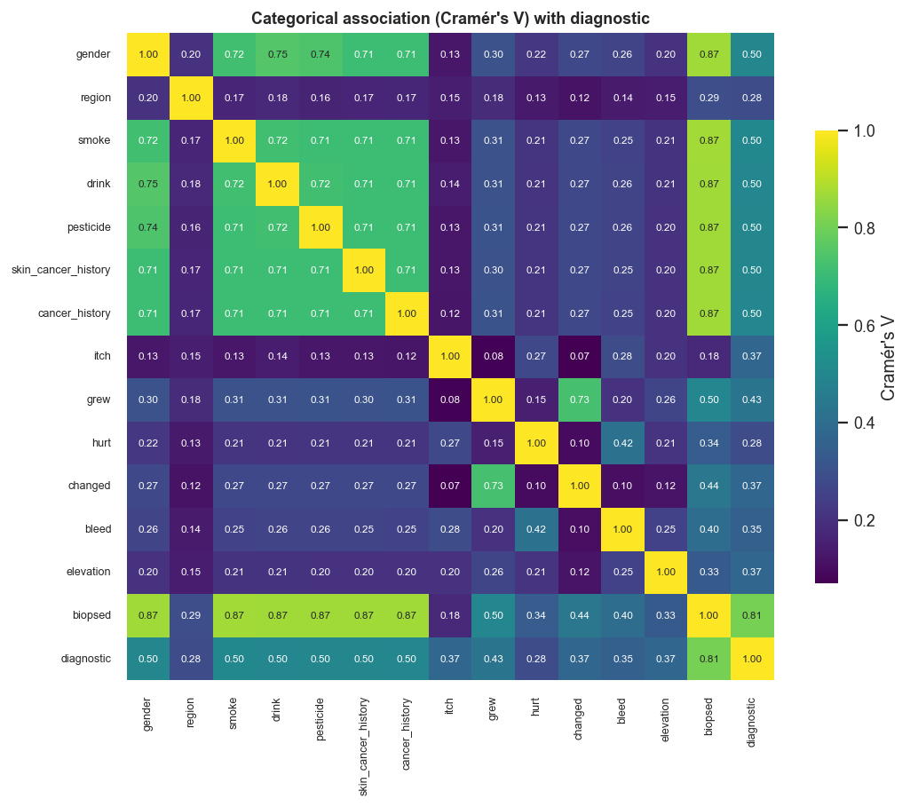
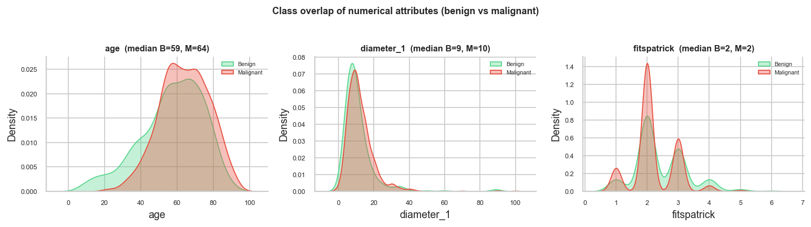
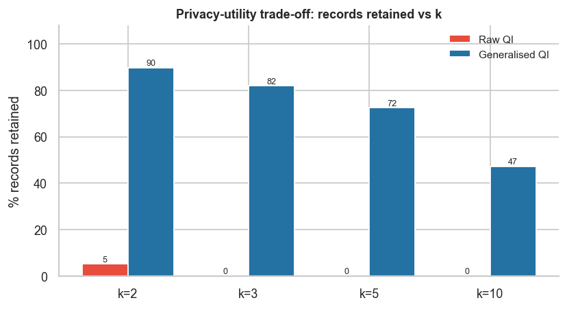

# Lo que un dataset médico no te cuenta: EDA y k-anonimato en PAD-UFES-20

> Un dataset de **lesiones de piel** (1 373 pacientes, 1 641 lesiones, 2 298 imágenes) parece listo para
> entrenar un modelo. Mirado con lupa, esconde un bloque de datos que falta a propósito, correlaciones
> que son un espejismo y una fuga entre train y test. Y luego está la otra pregunta: ¿cuánto cuesta
> proteger a los pacientes que hay detrás?

| Hallazgo | Cifra |
|---|---|
| Bloque clínico ausente en lesiones **no biopsiadas** / biopsiadas | 84.1 % / 0 % |
| V de Cramér de `smoke` con el diagnóstico: todas las filas → solo biopsiadas | 0.50 → **0.11** |
| Pacientes en train y test a la vez si se parte por imagen | **16.2 %** |
| Pacientes únicos por sus cuasi-identificadores (sin anonimizar) | 95 % |
| Registros conservados con k = 5 tras generalizar | 72.5 % |
| Melanomas conservados con k = 5 | 48 % |



---

## Índice

- [Tres trampas en los datos](#tres-trampas-en-los-datos)
- [Los datos](#los-datos)
- [Mirar antes de modelar](#mirar-antes-de-modelar)
- [Proteger a las personas](#proteger-a-las-personas)
- [Lo que me llevo](#lo-que-me-llevo)
- [Siguientes pasos](#siguientes-pasos)
- [Cómo ejecutarlo](#cómo-ejecutarlo)

---

## Tres trampas en los datos

1. **El espejismo de las correlaciones.** Fumar, beber o tener antecedentes de cáncer parecían muy
   asociados al diagnóstico (V ≈ 0.50). Pero esos campos solo existen para los pacientes biopsiados,
   que son sobre todo los malignos. Calculadas solo sobre biopsiados, las asociaciones se desploman;
   los síntomas "creció" y "cambió" sí aguantan.
2. **La fuga silenciosa.** Hay hasta 10 imágenes por paciente: un split por imagen pone al 16.2 % de
   los pacientes a ambos lados. El split tiene que hacerse por paciente.
3. **El proxy de la etiqueta.** `biopsed` es la variable más asociada al diagnóstico (V = 0.81)… porque
   se biopsia lo que parece maligno. Usarla como predictor sería hacer trampa.

## Los datos

Imágenes de [PAD-UFES-20](https://doi.org/10.1016/j.dib.2020.106221) (Kaggle,
`mahdavi1202/skin-cancer`) y un CSV de metadatos con identificadores **simulados** (DNI, ciudad, código
postal, hospital). Seis diagnósticos: tres malignos (BCC, MEL, SCC) y tres benignos (ACK, NEV, SEK), con
un desbalanceo de 16 a 1 entre BCC y MEL. Ni las imágenes (3.4 GB) ni el CSV están en el repo.

## Mirar antes de modelar

Cada asociación se reporta con su tamaño del efecto (V de Cramér con corrección de sesgo o Spearman) y
su p-value, y el mecanismo de los datos faltantes se contrasta con un χ² frente a la biopsia y el
diagnóstico.



- La malignidad sube con la edad (del 7 % en menores de 30 al 56 % en mayores de 70) y es mucho mayor en
  zonas expuestas al sol (nariz 84 %).
- La geografía no aporta información útil sobre el diagnóstico (V de 0.06 a 0.09).
- **Ausencia modelada, no imputada:** el bloque que falta se codifica como una categoría explícita
  `not_assessed`. La completitud sube de 0.857 a 0.952 sin perder registros ni inventar valores.



Ninguna variable numérica separa por sí sola benignas de malignas, y los dos diámetros de la lesión
están muy correlados (Spearman 0.89): basta con uno.

## Proteger a las personas

Sin tocar nada, el 95 % de los pacientes es **único** por sus cuasi-identificadores. El pipeline de
desidentificación:

1. **Clasificar** los atributos: identificadores directos, cuasi-identificadores y datos sensibles
   (categorías especiales del RGPD).
2. **Eliminar o pseudonimizar** los directos, con la tabla de correspondencias guardada aparte.
3. **Generalizar** los cuasi-identificadores: edad en tramos de 10 años, código postal y ciudad →
   provincia, hospital → provincia, ascendencia → macrorregión.
4. **Suprimir** los registros que no alcanzan k y verificar que todas las clases de equivalencia lo
   cumplen.



| k | Conservados (en bruto) | Conservados (generalizados) |
|---|---|---|
| 2 | 5.2 % | 89.8 % |
| 3 | 0.2 % | 81.9 % |
| 5 | 0.0 % | 72.5 % |
| 10 | 0.0 % | 47.3 % |

El valor de k y el nivel de generalización de la edad (exacta, 5, 10 o 20 años) se eligieron con
experimentos, no a ojo. Y el coste se midió **por diagnóstico**, no solo en global, para ver a quién
afecta la anonimización.

## Lo que me llevo

- La calidad de un dataset depende menos de su tamaño que de su estructura: el desbalanceo, el bloque
  clínico ausente y la jerarquía paciente → lesión → imagen.
- Restringir el análisis a los registros donde el dato existe evita conclusiones espurias.
- La privacidad tiene un coste que no se reparte por igual: a k = 5, el melanoma (la clase más rara y
  la más importante de detectar) conserva solo el 48 % de sus pacientes. Privacidad y representación
  justa hay que ajustarlas a la vez.

## Siguientes pasos

- Un k distinto por diagnóstico, o un mínimo de retención por clase, para proteger a las clases raras.
- *l*-diversidad sobre los atributos sensibles.
- Entrenar un clasificador sobre el dataset anonimizado para medir su utilidad real.

## Cómo ejecutarlo

Python con `pandas`, `numpy`, `scipy`, `matplotlib`, `seaborn` y `Pillow` (opcional: `kagglehub` para
las imágenes). Los notebooks esperan `_data/metadata_skin_cancer.csv` y `_data/images/`.

```
01_eda.ipynb          análisis exploratorio (tabular e imágenes)
02_privacidad.ipynb   desidentificación y k-anonimato
figures/              figuras exportadas
```

---

Proyecto desarrollado durante el Grado en Ingeniería de Sistemas de Inteligencia Artificial
(Universidad Francisco de Vitoria, 2025/26). Autor: Marco Larriba Rius.
